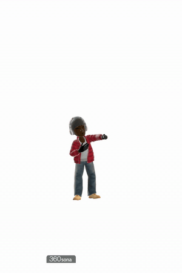
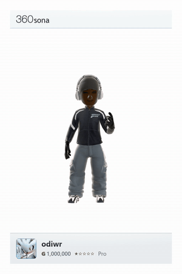
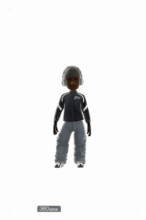

# SonaLoop

A small, unofficial exporter for [360sona](https://360sona.com).
Paste a display-case link, preview it, and export an MP4 or GIF. The installed
app opens its interface in your default browser, including Waterfox or Firefox.
It runs on `127.0.0.1` on your computer; there is no hosted SonaLoop site.
Supports ½×, 1×, 2×, and 3× resolution.

**This is a just-for-fun project, not an actively maintained app.**
Updates and support aren't promised. Changes to 360sona may break it.

## Examples

<p align="center">
  <a href="https://github.com/odiwr/SonaLoop/releases/download/v1.3.0/BBLDRIZZY.mp4"></a>&emsp;
  <a href="https://github.com/odiwr/SonaLoop/releases/download/v1.3.0/SK8.mp4"></a>&emsp;
  <a href="https://github.com/odiwr/SonaLoop/releases/download/v1.3.0/SonaLoop.mp4"></a>
</p>

## Download

Get your version from [Releases](https://github.com/odiwr/SonaLoop/releases).

- **Windows:** run `SonaLoop-Windows.exe`. It opens in your default browser. The app includes Chromium and a compatible Firefox engine for rendering; you can choose either in the app. Waterfox can display the interface, but cannot be selected as the rendering executable.
- **macOS:** unzip and open SonaLoop. The app is unsigned.
- **Linux:** extract the archive and run `SonaLoop/SonaLoop`.
- **Ubuntu 24.04+:** install the `.deb` with `sudo apt install ./sonaloop*.deb`.

For the Linux archive, install its desktop/browser dependencies:

```sh
sudo apt install libwebkit2gtk-4.1-0 gir1.2-webkit2-4.1 gir1.2-gtk-3.0 libnss3 libnspr4 libatk-bridge2.0-0 libxkbcommon0 libgbm1 libasound2t64
```

Internet is required to load the avatar. Exports stay on your computer.
Your browser handles saving exported files and snapshots. Closing the SonaLoop
tab stops its local server after it has been idle for about 90 seconds; you can
also use the × button in the interface to stop it immediately. No Python or
separate browser installation is needed. The optional `--desktop` mode uses
the older embedded window and requires WebView2 on Windows.
Synchronized mode repeats one animation and full turn; natural mode records the
original movement. Not every source animation has a seamless start and end.

Not affiliated with 360sona or Microsoft.
